# `zpane`

[](https://crates.io/crates/zpane)
[](https://github.com/zenthora/zpane/releases)
[](https://github.com/zenthora/zpane/actions/workflows/release.yml)
[](LICENSE)


**Blazing-fast 3-pane Miller Column Command, Subcommand, Parameter & Variable Explorer for PowerShell, macOS, Linux, Nushell, and Termux.**

`zpane` brings the spatial orientation of 3-column Miller file managers (`yazi`, `ranger`, `lf`) to interactive shell command construction. Instead of cycling through flat 1D tab-completion dropdowns or opening slow GUI dialogs (`Show-Command`), `zpane` lets you visually traverse commands, subcommands, PowerShell parameter sets, enum constraints, project tasks, and environment variables in a zero-flicker full-screen or inline terminal overlay—injecting the assembled command straight back into your active shell prompt buffer.



```text
╭ 1. Command / Scope (4921) ─────────┬ 2. Params [Set: Id] (19) ──────────────────┬ 3. Flags / Values / Info (11) ────────────────────╮
│   $env:Variables             [Env] │ ❯ -Id (-PID)                       [Param] │ ℹ -Id (-PID) [Param]                              │
│   $global:Variables          [Var] │   -FileVersionInfo                  [Flag] │   [Int32[]] Parameter -Id (-PID)                  │
│   git                        [CLI] │   -Module                           [Flag] │───────────────────────────────────────────────────│
│   prek                       [CLI] │   -IncludeUserName                  [Flag] │ ❯ ✏ (Type custom value / path)            [Value] │
│ ❯ Get-Process             [Cmdlet] │   -Verbose                          [Flag] │   $PWD (Current Dir)                        [Var] │
│   Get-ChildItem           [Cmdlet] │   -ErrorAction                     [Param] │   $HOME (User Home)                         [Var] │
├────────────────────────────────────┴────────────────────────────────────────────┴───────────────────────────────────────────────────┤
│ Filter (Pane 2): █   [P1: '' | P2: '' | P3: '']                                                                                     │
│ Command Line  : Get-Process -Id                                                                                                     │
│ [↑/↓|Ctrl+N/P] Move  [←/→] Pane  [Type] Filter  [Tab] Append  [Ctrl+O] Pipe  [F1] Inspect  [Ctrl+R] Sync PS  [Enter] Accept  [Esc]  │
╰─────────────────────────────────────────────────────────────────────────────────────────────────────────────────────────────────────╯
```

---

## Why `zpane`?

Modern terminal workflows straddle two worlds: **PowerShell's rich CLR object/cmdlet ecosystem** (`Verb-Noun`, `[ValidateSet]` enums, mutually exclusive `ParameterSets`, `$env:*` / `$global:*` scopes) and **polyglot native CLI executables** (`git`, `cargo`, `winget`, `gh`, `docker`, `uv`, `prek`, `dnf`, `apt`, `pacman`, `pkg`, `just`, `mise`). Existing tools only cover one piece of the puzzle:

| Capability | `zpane` | `bract` | `inshellisense` | `carapace-bin` | `Show-Command` | `PSReadLine` |
| :--- | :---: | :---: | :---: | :---: | :---: | :---: |
| **3-Pane Cascading Miller Layout (Full & Inline)** | **Yes** | Yes | No (1D Popup) | No (Host Menu) | No (WPF GUI) | No (2D Grid) |
| **Zero-Config Live CLI `--help` / `man` Parsing** | **Yes** | Yes | No (Static Specs) | No (Static Specs) | No | No |
| **PowerShell CLR Reflection & MAML Help** | **Yes** | No | No | Partial | Yes | Yes |
| **Dynamic `ParameterSet` Exclusivity Pruning** | **Yes** | No | No | No | Yes | No |
| **Interactive `$env` / `$SHELL` / `$nu` Inspector** | **Yes** | No | No | No | No | Partial |
| **In-Place Shell Prompt Buffer Replacement** | **Yes** | No | Yes | Yes | No | Yes |
| **Windows, macOS, Linux (x86_64/arm64) & Termux** | **Yes** | Unix | Node.js | Yes | Windows GUI | PowerShell |

See [`docs/prior-art-and-alternatives.md`](docs/prior-art-and-alternatives.md) for a deep-dive architectural comparison.

---

## Key Features

- **Dual-Engine Hybrid Discovery**:
  - **Rich PowerShell CLR Reflection & MAML Help (`ps_metadata.json`)**: Supports `pwsh` with automatic Windows PowerShell 5.1 (`powershell.exe`) fallback. Indexes Cmdlets, Functions, and Aliases with parameter types, shorthand Parameter Aliases, `[Switch]` flags (`[Flag]`), `[ValidateSet]` / `Enum` / `[ArgumentCompletions]` values, `[ValidateRange]` bounds, mandatory/positional/pipeline-binding metadata, `ParameterSet` memberships, optional user-profile sync (`sync_profile = true`), and lazy MAML `*-Help.xml` / `Get-Help` documentation enrichment.
  - **Asynchronous JIT CLI Introspection (`cli_cache_<dialect>.json`)**: Scans `PATH` for native executables (`.exe`/`.cmd`/`.bat` on Windows; `+x` binaries and symlinks on macOS, Linux, and Termux) and lazily introspects `--help` / `-h` in a LIFO-prioritized background worker with lazy executable fingerprinting and a configurable timeout (`introspect_timeout_ms`, default `750`ms). Includes section-aware grammar parsers for **Cobra** (`gh`, `kubectl`, `docker`), **Clap** (`cargo`, `rg`, `fd`, `prek`), **Knack / Argparse** (`az`, Python CLIs), **winget**, and **git** (`-h`), plus Unix **`man`-page** fallback when `--help` yields no options.
- **Declarative Specs, Carapace Bridge & Project-Local Tasks**:
  - Loads custom `carapace-spec` (`.yaml`/`.yml`/`.json`) and simplified Fig (`.json`) specs in XDG precedence order (`zpane/specs` → `carapace/specs` → legacy cache fallback), queries `carapace <cmd> export` automatically when `--help`/`-h` parsing yields no entries, and discovers project-local tasks in the current working directory without spawning subprocesses (`package.json`, `justfile`/`.justfile`, `GNUmakefile`/`makefile`/`Makefile`, `mise.toml`/`.mise.toml`).
- **Dynamic Runtime Context, Cursor-Aware Editing & Pipeline Chaining**:
  - Automatically detects Git branches (including linked worktrees), working-directory entries, and shell history (`ConsoleHost_history.txt`, `~/.zsh_history`, `~/.bash_history`, `fish_history`, Nushell `history.txt`), indexes shell RC aliases/functions, displays subcommand breadcrumb trails and committed-token markers, preserves trailing prompt text via `--cursor <OFFSET>`, and chains pipeline stages in place with `Ctrl+O` / `Alt+|`.
- **Inline & Full-Screen Rendering, Themes, `NO_COLOR` & Custom Keybindings**:
  - Render either full-screen on the alternate buffer or inline below the prompt with `--height <ROWS|PCT>` (e.g. `18`, `45%`; `100%` for full-screen) or `[ui].height` + `[ui].min_height`. Customize `theme` (`dark`, `light`, `ansi16`, `none`), `icons` (`unicode`, `ascii`), `borders` (`rounded`, `plain`, `ascii`), and `[keybindings]` in `config.toml`; `NO_COLOR` and `TERM=dumb` automatically switch to monochrome bold/reverse rendering.
- **Automatic Shell Dialect Adaptation (`PowerShell`, `POSIX`, `Fish`, and `Nushell`)**:
  - Emits `$env:VAR` in `PowerShell`, `$VAR` / `$?` / `$!` in `POSIX` (`bash`/`zsh`/`sh`/Termux), `$VAR` / `$status` / `$last_pid` / `$fish_pid` in `Fish`, and `$env.VAR` / `$nu.*` / `$in` in `Nushell` (auto-detected via `NU_VERSION`, `PSModulePath`, `FISH_VERSION`, `SHELL`, or OS default; override anytime with `ZPANE_SHELL=pwsh|posix|fish|nu`).
- **Dynamic `ParameterSet` Exclusivity Pruning**:
  - Selecting a parameter bound to a specific PowerShell `ParameterSet` (e.g., `Get-Process -Id`) automatically prunes incompatible parameters (such as `-Name`) from Pane 2 and displays the active set in the pane header (`2. Params [Set: Id]`).
- **Interactive Value Prompts & Scrollable Inspector**:
  - Typing in Pane 3 dynamically creates an interactive `✏ Use "<value>"` entry (inspired by `navi`), while `F1` / `Alt+I` / `Alt+?` opens a scrollable full-description Inspector drawer showing aliases, Parameter Sets, mandatory/positional/pipeline metadata, and MAML docs.
- **Read-Only Diagnostics (`zpane doctor [--json]`)**:
  - Inspect detected Shell Dialect and reason, `config.toml` diagnostics and active overrides, cache status/entry counts/age, XDG spec search directories and loaded specs, external provider availability (`pwsh`, `powershell.exe`, `carapace`, `man`), and runtime context without touching or creating any files.
- **Sub-Millisecond Synchronized Terminal Rendering**:
  - Renders directly to `CONOUT$` (Windows) or `/dev/tty` (macOS/Linux/Termux) with DEC Mode 2026 Synchronized Output (`\x1b[?2026h`…`\x1b[?2026l`), event-burst coalescing, and zero-allocation fuzzy subsequence matching (~85µs per interactive step across 5,000+ commands).

---

## Installation

### `cargo-binstall` / Cargo (`crates.io` / Source)

```powershell
# Download prebuilt binary from GitHub Releases (no compilation)
cargo binstall zpane

# Or compile & install published release from crates.io
cargo install zpane

# Or build and install from a local checkout
cargo install --path .

# Optional: pre-warm PowerShell metadata & priority CLI cache
zpane --warm
```

### Homebrew (macOS arm64/x86_64 & Linux arm64/x86_64)

Rendered release formulas are generated from [`packaging/homebrew/zpane.rb`](packaging/homebrew/zpane.rb) and published to the tap:

```bash
brew install zenthora/tap/zpane
```

### Scoop (Windows x86_64)

Release manifests are rendered from [`packaging/scoop/zpane.json`](packaging/scoop/zpane.json):

```powershell
scoop install https://github.com/zenthora/zpane/releases/latest/download/zpane.json
```

### WinGet (Windows x86_64)

WinGet manifests live under [`packaging/winget/`](packaging/winget/) (`PackageIdentifier: zenthora.zpane`):

```powershell
winget install zenthora.zpane
```

### Prebuilt Release Archives

Each GitHub Release publishes deterministic archives and `SHA256SUMS` for:
- **Windows (`x86_64`)**: `zpane-v0.5.2-x86_64-pc-windows-msvc.zip`
- **macOS (`arm64` & `x86_64`)**: `zpane-v0.5.2-aarch64-apple-darwin.tar.gz`, `zpane-v0.5.2-x86_64-apple-darwin.tar.gz`
- **Linux (`x86_64` & `aarch64` static musl)**: `zpane-v0.5.2-x86_64-unknown-linux-musl.tar.gz`, `zpane-v0.5.2-aarch64-unknown-linux-musl.tar.gz`

### Arch Linux (`pacman` / `makepkg`)

Install the prebuilt `.pkg.tar.zst` release package (`x86_64` or `aarch64`) or build from [`packaging/arch/PKGBUILD`](packaging/arch/PKGBUILD):

```bash
# Install release package directly
sudo pacman -U dist/zpane-0.5.2-1-x86_64.pkg.tar.zst

# Or build from PKGBUILD
cd packaging/arch && makepkg -si
```

### Debian / Ubuntu (`.deb` — `amd64` & `arm64`)

```bash
sudo dpkg -i dist/zpane_0.5.2-1_amd64.deb
```

### Fedora / RHEL / openSUSE (`.rpm` — `x86_64` & `aarch64`)

Install the prebuilt `.rpm` package via `dnf` / `rpm` or build from [`packaging/fedora/zpane.spec`](packaging/fedora/zpane.spec):

```bash
sudo dnf install ./dist/zpane-0.5.2-1.x86_64.rpm
# or
sudo rpm -Uvh dist/zpane-0.5.2-1.x86_64.rpm
```

### Android Termux (`aarch64`)

Install the Termux `.deb` package (built with the `/data/data/com.termux/files/usr` prefix) or see [`packaging/termux/build.sh`](packaging/termux/build.sh):

```bash
dpkg -i zpane_0.5.2_aarch64.deb
zpane --warm
```

---

## Shell Integration

Generate and evaluate the integration script directly with `zpane init` (defaults to `Alt+m`; override with `--bind <CHORD>` such as `--bind Ctrl+g`, `--bind Ctrl+Space`, `--bind F2`, or pass `--no-bind` to define only the widget/helper without registering a keybinding):

- **PowerShell (`$PROFILE`)**: `Invoke-Expression (& zpane init pwsh | Out-String)`
- **Zsh (`~/.zshrc`)**: `eval "$(zpane init zsh)"`
- **Bash (`~/.bashrc`)**: `eval "$(zpane init bash)"`
- **Fish (`~/.config/fish/config.fish`)**: `zpane init fish | source`
- **Nushell (`config.nu`)**: save `zpane init nu | save -f ~/.config/nushell/zpane.nu` and add `source ~/.config/nushell/zpane.nu`

Or paste the explicit snippets below:

### PowerShell (`$PROFILE`)

Bind `Alt+M` in `PSReadLine` to open `zpane` seeded with your current prompt line, cursor offset, recent history, and live session variables/functions, replacing the buffer in place upon pressing `Enter`:

```powershell
function Invoke-ZpaneWidget {
    $line = $null
    $cursor = $null
    [Microsoft.PowerShell.PSConsoleReadLine]::GetBufferState([ref]$line, [ref]$cursor)
    if ($null -eq $line) { $line = '' }
    if ($null -eq $cursor -or $cursor -lt 0) { $cursor = $line.Length }

    $tmp = $null
    $ctxFile = $null
    try {
        $tmp = [System.IO.Path]::GetTempFileName()
        $ctxFile = [System.IO.Path]::GetTempFileName()

        $histPath = (Get-PSReadLineOption).HistorySavePath
        $recent = @()
        if ($histPath -and (Test-Path -LiteralPath $histPath)) {
            $recent = @(Get-Content -LiteralPath $histPath -Tail 15 -Encoding UTF8 -ErrorAction SilentlyContinue)
            if ($recent.Count -gt 1) {
                [array]::Reverse($recent)
            }
        }
        $sVars = @(Get-Variable -Scope Global -ErrorAction SilentlyContinue | Where-Object {
            $_.Name -match '^[A-Za-z_][A-Za-z0-9_]*$' -and
            $_.Name -notmatch '^(PWD|HOME|PROFILE|PID|PSVersionTable|PSHOME|PSUICulture|PSCulture|ExecutionContext|Host|MyInvocation|PSBoundParameters|PSCmdlet|PSCommandPath|PSScriptRoot|Sender|Event|EventArgs|EventSubscriber|SourceArgs|SourceEventArgs|Matches|LastExitCode|Error|StackTrace|Input|Args|OFS|ConfirmPreference|DebugPreference|ErrorActionPreference|InformationPreference|ProgressPreference|VerbosePreference|WarningPreference|WhatIfPreference|FormatEnumerationLimit|MaximumHistoryCount|OutputEncoding|NestedPromptLevel|ShellId|true|false|null|_)$' -and
            ($_.Value -is [string] -or $_.Value -is [ValueType])
        } | Select-Object -First 64 | ForEach-Object {
            $vStr = ("$($_.Value)" -replace '[\r\n]+', ' ')
            if ($vStr.Length -gt 120) { $vStr = $vStr.Substring(0, 120) }
            @{ name = $_.Name; value = $vStr }
        })
        $sFuncs = @(Get-ChildItem Function: -ErrorAction SilentlyContinue | Where-Object {
            -not $_.ModuleName -and $_.Name -notmatch '^([A-Za-z]:|__|TabExpansion|Prompt|Clear-Host|more|oss|help|Pause|cd\.\.|cd\\)$'
        } | Select-Object -First 128 | ForEach-Object {
            @{ name = $_.Name; desc = 'Session function' }
        })
        $ctxPayload = @{
            history       = @($recent)
            session_vars  = @($sVars)
            session_funcs = @($sFuncs)
        } | ConvertTo-Json -Depth 4 -Compress
        [System.IO.File]::WriteAllText($ctxFile, $ctxPayload, [System.Text.UTF8Encoding]::new($false))

        if (-not [string]::IsNullOrEmpty($line)) {
            $legacyNativeArgs = ($PSVersionTable.PSVersion.Major -lt 7) -or
                ($PSVersionTable.PSVersion.Major -eq 7 -and $PSVersionTable.PSVersion.Minor -lt 3) -or
                ((Get-Variable -Name PSNativeCommandArgumentPassing -ValueOnly -ErrorAction SilentlyContinue) -eq 'Legacy')
            $initVal = if ($legacyNativeArgs) {
                $escaped = $line -replace '(\\*)"', '$1$1\"'
                if ($escaped -match '\s') { $escaped -replace '(\\+)$', '$1$1' } else { $escaped }
            } else {
                $line
            }
            zpane --initial "$initVal" --cursor "$cursor" --context-file "$ctxFile" --out-file "$tmp"
        } else {
            zpane --context-file "$ctxFile" --out-file "$tmp"
        }
        if ($LASTEXITCODE -eq 0 -and (Test-Path -LiteralPath $tmp)) {
            $accepted = [System.IO.File]::ReadAllText($tmp, [System.Text.UTF8Encoding]::new($false))
            if ($accepted) {
                $accepted = $accepted.Trim()
                if ($accepted) {
                    [Microsoft.PowerShell.PSConsoleReadLine]::Replace(0, $line.Length, $accepted)
                }
            }
        }
    } finally {
        if ($tmp) { Remove-Item -LiteralPath $tmp -Force -ErrorAction SilentlyContinue }
        if ($ctxFile) { Remove-Item -LiteralPath $ctxFile -Force -ErrorAction SilentlyContinue }
    }
}
Set-PSReadLineKeyHandler -Chord 'Alt+m' -ScriptBlock { Invoke-ZpaneWidget }
```

### Zsh (`~/.zshrc`)

```zsh
_zpane_widget() {
    setopt localoptions localtraps
    local tmp line
    local -a hist_args
    tmp="$(umask 077 && mktemp)" || return
    trap 'rm -f -- "$tmp"' EXIT INT TERM
    hist_args=()
    while IFS= read -r line; do
        line="${line#"${line%%[![:space:]]*}"}"
        [[ -n "$line" ]] && hist_args=(--history "$line" "${hist_args[@]}")
    done < <(fc -ln -15 2>/dev/null || true)
    if zpane --initial "$BUFFER" --cursor "$CURSOR" "${hist_args[@]}" --out-file "$tmp" && [[ -s "$tmp" ]]; then
        BUFFER="$(<"$tmp")"
        CURSOR=${#BUFFER}
    fi
    rm -f -- "$tmp"
    zle redisplay
}
zle -N _zpane_widget
bindkey '^[m' _zpane_widget
```

### Bash (`~/.bashrc`)

```bash
_zpane_readline() {
    local tmp line
    local -a hist_args=()
    tmp="$(umask 077 && mktemp)" || return
    trap 'rm -f -- "$tmp"' RETURN INT TERM
    while IFS= read -r line; do
        if [[ "$line" =~ ^[[:space:]]*[0-9]+\*?[[:space:]]+(.+)$ ]]; then
            hist_args=(--history "${BASH_REMATCH[1]}" ${hist_args[@]+"${hist_args[@]}"})
        fi
    done < <(HISTTIMEFORMAT='' history 15 2>/dev/null || true)
    if zpane --initial "$READLINE_LINE" --cursor "$READLINE_POINT" ${hist_args[@]+"${hist_args[@]}"} --out-file "$tmp" && [[ -s "$tmp" ]]; then
        READLINE_LINE="$(<"$tmp")"
        READLINE_POINT=${#READLINE_LINE}
    fi
    rm -f -- "$tmp"
    trap - RETURN INT TERM
}
bind -x '"\em": _zpane_readline'
```

### Fish (`~/.config/fish/config.fish`)

```fish
function _zpane_fish
    set -l old_umask (umask)
    umask 077
    set -l tmp (mktemp)
    set -l mk_status $status
    umask $old_umask
    test $mk_status -eq 0; or return

    set -l buf (commandline -b | string join \n)
    set -l cursor (commandline -C)
    set -l hist_args
    for h in (history --max 15 2>/dev/null)
        set -l trimmed (string trim -- "$h")
        if test -n "$trimmed"
            set -a hist_args --history "$trimmed"
        end
    end
    if test (count $buf) -gt 0
        zpane --initial "$buf" --cursor "$cursor" $hist_args --out-file "$tmp"
    else
        zpane --initial "" --cursor 0 $hist_args --out-file "$tmp"
    end
    if test $status -eq 0 -a -s "$tmp"
        set -l accepted (string trim -- (string collect < "$tmp"))
        if test -n "$accepted"
            commandline -r -- "$accepted"
            commandline -C (string length -- "$accepted")
        end
    end
    rm -f -- "$tmp"
    commandline -f repaint
end
bind \em _zpane_fish
```

### Nushell (`config.nu`)

```nu
def _zpane_widget [] {
    let line = (commandline)
    let cursor = (commandline get-cursor)
    let tmp = (mktemp -t zpane.XXXXXX)
    let hist_args = (
        try {
            history
            | last 15
            | get command
            | reverse
            | where {|c| ($c | str trim | is-not-empty) }
            | each {|c| ["--history", ($c | str trim)] }
            | flatten
        } catch { [] }
    )
    try {
        ^zpane --initial $line --cursor ($cursor | into string) ...$hist_args --out-file $tmp
        if $env.LAST_EXIT_CODE == 0 and ($tmp | path exists) {
            let accepted = (open --raw $tmp | str trim)
            if ($accepted | is-not-empty) {
                commandline edit --replace $accepted
                commandline set-cursor ($accepted | str length)
            }
        }
    } catch { }
    if ($tmp | path exists) {
        rm -f $tmp
    }
}
$env.config.keybindings = (
    ($env.config.keybindings? | default [])
    | append {
        name: zpane_widget
        modifier: alt
        keycode: char_m
        mode: [emacs, vi_normal, vi_insert]
        event: { send: executehostcommand, cmd: "_zpane_widget" }
    }
)
```

---

## Declarative Specs, Carapace Bridge & Project Tasks

- **Declarative Spec Precedence** (`.yaml`, `.yml`, `.json` — `carapace-spec` or simplified Fig JSON):
  1. `$XDG_CONFIG_HOME/zpane/specs` (`~/.config/zpane/specs` on Unix; `%APPDATA%\zpane\specs` then `%LOCALAPPDATA%\zpane\specs` on Windows)
  2. `$XDG_CONFIG_HOME/carapace/specs` (`~/.config/carapace/specs` on Unix; `%APPDATA%\carapace\specs` then `%LOCALAPPDATA%\carapace\specs` on Windows)
  3. Legacy cache fallback (`$XDG_CACHE_HOME/zpane/specs`, `~/.cache/zpane/specs`, or `%LOCALAPPDATA%\zpane\specs`)
- **Carapace Bridge**: If [`carapace`](https://carapace.sh/) is installed on `PATH`, `zpane` queries `carapace <cmd> export` automatically whenever `--help`/`-h` parsing yields no entries.
- **Project-Local Tasks**: When running inside a project directory, `zpane` automatically parses `package.json` (`npm run`, `pnpm`, `bun`), `justfile`/`.justfile` (`just`), `GNUmakefile`/`makefile`/`Makefile` (`make`), and `mise.toml`/`.mise.toml` (`mise run`) with zero subprocess spawning.

---

## Keyboard Shortcuts

| Key | Action |
| :--- | :--- |
| <kbd>↑</kbd> / <kbd>↓</kbd> / <kbd>Ctrl+N</kbd> / <kbd>Ctrl+P</kbd> | Move selection up / down in the active Pane (also <kbd>Ctrl+J</kbd> / <kbd>Ctrl+K</kbd> and <kbd>Alt+J</kbd> / <kbd>Alt+K</kbd>; scrolls when the Inspector is expanded) |
| <kbd>PgUp</kbd> / <kbd>PgDn</kbd> | Jump one visible screenful up / down in the active Pane or expanded Inspector |
| <kbd>Home</kbd> / <kbd>End</kbd> | Jump to first / last Entry in the active Pane or top / bottom of the expanded Inspector |
| <kbd>→</kbd> / <kbd>←</kbd> | Move focus to the next / previous Pane (also <kbd>Alt+L</kbd> / <kbd>Alt+H</kbd>, <kbd>Ctrl+F</kbd> / <kbd>Ctrl+B</kbd>; slides into nested subcommand chains on <kbd>Subcmd</kbd>) |
| <kbd>Tab</kbd> | Append the highlighted token/flag/value to the Command Line and advance (quotes spaced custom values) |
| <kbd>Ctrl+O</kbd> / <kbd>Alt+\|</kbd> | Commit the current stage with `\|` and start composing the next command in a pipeline |
| `Type any char` | Fuzzy-filter the active Pane (or type a custom argument value in Pane 3) |
| <kbd>Backspace</kbd> | Delete the last filter character, or pop the last Committed Token if the filter is empty |
| <kbd>Ctrl+U</kbd> | Clear the active Pane's fuzzy filter |
| <kbd>F1</kbd> / <kbd>Alt+I</kbd> / <kbd>Alt+?</kbd> | Toggle expanded scrollable multi-line Inspector drawer in Pane 3 (full description, aliases, Parameter Sets, MAML help) |
| <kbd>Ctrl+R</kbd> | Invalidate active CLI cache + re-sync PowerShell metadata (`Sync PS`) or reload the Command Catalog (`Reload`) |
| <kbd>Enter</kbd> | Accept the assembled Command Line and exit |
| <kbd>Esc</kbd> / <kbd>Ctrl+C</kbd> | Close expanded Inspector (if open), or cancel and exit without modifying the prompt |

---

## Configuration (`config.toml`)

Create `%LOCALAPPDATA%\zpane\config.toml` (Windows) or `~/.config/zpane/config.toml` (`$XDG_CONFIG_HOME/zpane/config.toml` on Unix, or override via `ZPANE_CONFIG`):

```toml
[discovery]
history_limit = 20
introspect_timeout_ms = 750   # 100..=10000 ms
sync_profile = false          # set true to load your PowerShell $PROFILE during --sync-ps
priority_tools = ["git", "cargo", "rg"]
disabled_tools = ["unwanted-bin"]

[ui]
theme = "dark"                # dark | light | ansi16 | none (NO_COLOR / TERM=dumb force none)
icons = "unicode"             # unicode | ascii
borders = "rounded"           # rounded | plain | ascii
height = "45%"                # optional inline height: rows (e.g. 18) or percentage (e.g. "45%", "100%")
min_height = 15               # minimum terminal rows required for inline mode (falls back to full screen below)

[keybindings]
confirm = "ctrl+y"
toggle_inspector = "f2"
chain_pipeline = "alt+|"
```

Top-level keys (`priority_tools`, `disabled_tools`, `history_limit`, `introspect_timeout_ms`, `sync_profile`) remain backward-compatible outside `[discovery]`. Run `zpane doctor` anytime to inspect resolved paths, active overrides, and non-fatal config diagnostics.

---

## Diagnostics (`zpane doctor`)

Run `zpane doctor` (or `zpane doctor --json` / `zpane --doctor --json`) for a strictly read-only summary of detected Shell Dialect & reason, `config.toml` status/diagnostics/overrides, `ps_metadata.json` & `cli_cache_<dialect>.json` cache health, XDG spec search directories & loaded specs, external provider availability (`pwsh`, `powershell.exe`, `carapace`, `man`), and runtime context (Git branch, shell history source/count, CWD project task files):

```bash
zpane doctor
zpane doctor --json
```

---

## CLI Options

```text
zpane - 3-pane Miller column command, parameter & variable explorer

Usage: zpane [OPTIONS] [--] [INITIAL_TOKENS]...
       zpane init <pwsh|zsh|bash|fish|nu> [--bind <CHORD> | --no-bind]
       zpane inspect [--json] <CMD>...
       zpane doctor [--json]

Options:
      --initial <TEXT>       Seed the command builder with an existing command buffer
      --cursor <OFFSET>      Cursor character offset in --initial (preserves trailing suffix verbatim)
      --out-file <PATH>      Write the accepted command to <PATH> instead of stdout
      --width <COLS>         Fallback terminal width (default: 120)
      --height <ROWS|PCT>    Inline height in rows or % (e.g. 18, 45%; 100% = full screen) & fallback
      --context <JSON>       Dynamic runtime context JSON payload (git branch, cwd, history)
      --context-file <PATH>  Read dynamic runtime context JSON payload from <PATH>
      --git-branch <NAME>    Override current Git branch name for runtime context
      --history <CMD>        Add a recent command to the top of Pane 1 (repeatable)
      --init <SHELL>         Print shell integration snippet (`pwsh`, `zsh`, `bash`, `fish`, `nu`) and exit
      --bind <CHORD>         Keybinding chord for `init`/`--init` (e.g. `Alt+m`, `Ctrl+g`, `Ctrl+Space`, `F2`)
      --no-bind              Define the shell init widget/helper without registering a keybinding
      --inspect <CMD>        Inspect a command or subcommand chain non-interactively and exit
      --doctor               Print read-only environment, config, cache, spec & provider diagnostics and exit
      --json                 Emit machine-readable JSON for non-interactive commands
      --sync-ps              Sync PowerShell cmdlet & parameter metadata (pwsh or powershell.exe) and exit
      --warm                 Sync PowerShell metadata (if available) + pre-warm CLI help cache and exit
      --clear-cache          Delete persisted CLI help & PowerShell metadata cache files and exit
  -h, --help                 Print help
  -V, --version              Print version

Environment:
  ZPANE_SHELL                Force token dialect: `pwsh` ($env:X), `posix` ($X), `fish` ($status), or `nu` ($env.X)
  ZPANE_CONFIG               Override user config path (`config.toml`)
  NO_COLOR                   Disable ANSI color output when set to any non-empty value (uses bold/reverse only)
```

---

## Development & Release Packaging

This repository uses [`prek`](https://prek.j178.dev) for `pre-commit` / `commit-msg` hooks and [`git-cliff`](https://git-cliff.org) for SemVer calculation and changelog generation:

```powershell
# Install git pre-commit and commit-msg (Conventional Commits) hooks
prek install

# Run formatting, clippy, tests, and config checks across all files
prek run --all-files

# Compute next SemVer via git-cliff, sync version manifests, and update CHANGELOG.md
prek run --stage manual git-cliff-changelog
```

## License

Licensed under the [MIT License](LICENSE).
